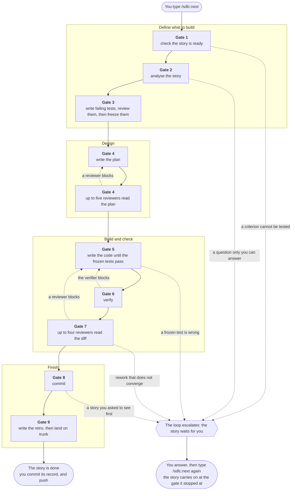

# The loop

- [Introduction](#introduction)
  - [The words these pages use](#the-words-these-pages-use)
- [A story from start to end](#a-story-from-start-to-end)
  - [Where a story stands](#where-a-story-stands)
- [The gates, one by one](#the-gates-one-by-one)
  - [Gate 1: check the story is ready](#gate-1-check-the-story-is-ready)
  - [Gate 2: analyse the story](#gate-2-analyse-the-story)
  - [Gate 3: freeze the tests](#gate-3-freeze-the-tests)
  - [Gate 4: plan, and review the plan](#gate-4-plan-and-review-the-plan)
  - [Gate 5: write the code](#gate-5-write-the-code)
  - [Gate 6: verify](#gate-6-verify)
  - [Gate 7: review the code](#gate-7-review-the-code)
  - [Gate 8: commit](#gate-8-commit)
  - [Gate 9: write the retro, and land](#gate-9-write-the-retro-and-land)
  - [Who runs the commands](#who-runs-the-commands)
- [Where you come in](#where-you-come-in)
- [Two kinds of decision](#two-kinds-of-decision)
- [Rework](#rework)
  - [The arbiter](#the-arbiter)
- [The scout rule](#the-scout-rule)
- [The review policy](#the-review-policy)
- [Why approvals go stale](#why-approvals-go-stale)
- [More than one checkout](#more-than-one-checkout)
  - [Working several stories at once](#working-several-stories-at-once)
  - [Which checkout holds a story](#which-checkout-holds-a-story)
  - [Done when it lands](#done-when-it-lands)
  - [Parallel stories and `CODEMAP.md`](#parallel-stories-and-codemapmd)
  - [Removing a worktree](#removing-a-worktree)
  - [With worktrees turned off](#with-worktrees-turned-off)
- [Where everything lives](#where-everything-lives)
  - [The trace](#the-trace)
- [Where to go next](#where-to-go-next)

## Introduction

The loop is what happens to a story between the moment you type `/sdlc:next`
and the moment its commits are on trunk. It takes one story through nine
gates, in order, and each gate has to pass before the next one begins.

Three ideas run through all nine. The tests are written from your acceptance
criteria and frozen before any code exists, so the code is held to what you
asked for. Every piece of work is checked by an agent that never saw the
reasoning behind it. And nothing is taken on trust: a gate passes only when the
work it stands for is really there, and `sdlc` refuses to record it otherwise.

You don't need this page to run a story.
[Getting started](getting-started.md) is enough for that. Read this one when
you want to know what the loop is doing while you wait, why it stopped, or how
far to trust what came out of it. It follows a story gate by gate, says what
each gate may ask of you, and then explains the rules that hold the gates
together: who decides what, rework, findings, stale approvals and the
landing.

### The words these pages use

A few words carry a fixed meaning on every page:

- **A gate** is one of the nine numbered checkpoints a story passes through.
  Each one is recorded as passed or failed, with a note.
- **The conversation** is the Claude Code session you typed `/sdlc:next` into.
  It runs the loop and hands each gate to the agent whose job it is.
- **The hook** is the part of `sdlc` that Claude Code runs before anything an
  agent does. It refuses what the loop's rules do not allow, and
  [Enforcement](enforcement.md) lists those rules.
- **The freeze** is the record of every test file as it stood when Gate 3
  passed. Frozen tests cannot be edited by any agent, and only a person lifts a
  freeze.
- **Trunk** is the branch your finished work lands on. Your project may call it
  `main`, and `sdlc` uses your name for it in what it prints.
- **To escalate** is to hand the story to a person and stop. The story then
  waits for your answer, for as long as you need.
- **Blocking** and **advisory** say whether a reviewer's block stops its gate.
  An advisory review is still required: the gate waits for it, and its findings
  count.
- **A person** is whoever is at the keyboard. Some decisions are a person's
  alone, such as approving a story or lifting a freeze, and the hook refuses
  them from an agent.
- **To land** is to move trunk forward to a finished story's commits. A story
  is done when it lands.
- **The team** is the agents your project runs, set in the
  [`team`](configuration.md#team) section of `.sdlc/config.json`: whether each
  takes part, whether a reviewer's block can stop a gate (`can_block`), and how
  many instances of a reviewer there are.
- **An instance** is one more review by the same reviewer, under a name of its
  own. With two instances of the security reviewer, a gate waits for
  `security` and for `security-2`.
- **The staffing** is, for one story, which of those agents it needs, and the
  model and effort each is asked for. It is not the plan, which says how the
  change is made and not who makes it.

## A story from start to end

You type `/sdlc:next`. The loop takes the next story marked `ready` and makes
it a worktree: a second checkout of your repository at `.sdlc/worktrees/<ID>`,
on a new branch named `story/<ID>`. Everything that follows happens there, so
your own checkout is left alone.

The story is checked for readiness and analysed. Tests are written that fail,
and then frozen. A plan is written and reviewed. The code is written until the
frozen tests pass, then verified, then reviewed. Only then is it committed. A
retro is written, and the story lands on trunk.

When something is wrong, the loop goes back to the gate that can fix it. When
it cannot fix it, it escalates. In this picture the solid arrows are the way
through, the dotted ones are the ways back, and the rounded boxes are yours:



Thirteen agents do the work between them, and
[Agents](the-agents.md#who-does-what) introduces each one. A story that needs
no rework runs an agent eighteen times: the project manager twice, one agent
each at Gates 2, 5, 6 and 9, two at Gate 3, six at Gate 4 and four at Gate 7.
Rework adds to that, and a reviewer the staffing leaves out takes one away.

Here is the same journey as a table:

| Gate | What happens | Who does it | What it leaves you to read | `sdlc status` calls it |
| --- | --- | --- | --- | --- |
| 1 | the criteria are checked: can each be tested? | the conversation | nothing | `dor` |
| 2 | the story is read against your code | the researcher | `ANALYSIS.md`, `THREATS.md` | `analysis` |
| 3 | a failing test is written for each criterion, the tests are reviewed, and then they are frozen | the test author, then the test reviewer | `TEST-PLAN.md`, the tests, and the review | `tests_frozen` |
| 4 | a plan is written, then reviewed | the implementer, then up to five reviewers | `PLAN.md`, and the reviews | `plan`, then `design_review` |
| 5 | the code is written until the frozen tests pass, and then your build, tests and checks are run | the implementer, then `sdlc` | the code | `implementation` |
| 6 | the work is verified by an agent that saw none of it | the verifier | `VERIFICATION.md`, and its verdict | `verification`, then `verifier_review` |
| 7 | the diff is reviewed | up to four reviewers | the reviews | `code_review` |
| 8 | the story is committed | the conversation | the commit, on `story/<ID>` | `commit` |
| 9 | the retro is written, and the story lands | the bookkeeper, then `sdlc stop` | `RETRO.md` | `retro` |

### Where a story stands

To see how far a story has got, run `sdlc status` in its worktree. This story
has passed Gate 7 and is about to be committed:

```console
$ cd .sdlc/worktrees/AUTH-3
$ sdlc status
AUTH-3  in progress  Reject expired sessions

  dor              pass  criteria are testable
  analysis         pass  no trust boundary
  tests_frozen     pass  2 criteria, 1 failing test
  plan             pass  2 steps
  design_review    pass  five reviews
  implementation   pass  frozen tests pass
  verification     pass  every command green
  verifier_review  pass  verified
  code_review      pass  four reviews

  tests  1 test file frozen at 2026-11-24T09:15:19Z
  cost   $0.00 of $60.00 (0%)

  staffing  recorded: every agent is needed

  next   commit
  pause  the commit will not pause: the story's risk tier is low, which pre_commit_pause_tiers does not pause; pre_commit_pause_paths lists no path

  backlog  1 ready · 1 in progress
  held     AUTH-3  in "/home/<user>/src/billing/.sdlc/worktrees/AUTH-3", this checkout

A person types /sdlc:next in Claude Code to carry on, or runs `sdlc stop` to put it down.
```

Each line at the top is a gate's outcome and the note recorded with it. There
are eleven of those lines for nine gates, because Gates 4 and 6 each record the
work and then the review of it: the plan and its design review, the
verification and the verifier's verdict. `next` is the gate the loop takes up
when you type `/sdlc:next`, and `pause` says whether the commit will
[wait for you](#gate-8-commit).

## The gates, one by one

Every gate has the same shape. The work is handed to an agent that starts from
a fresh context. The agent stores what it produced through `sdlc`, never as a
loose file. Then the outcome is recorded, and `sdlc` refuses to record a pass
unless the work is there. A summary saying a document exists is not the
document.

### Gate 1: check the story is ready

The conversation reads each acceptance criterion as a test author would. A
criterion that describes how the code is built, and not a behaviour somebody
could observe, fails the gate here. That is the cheapest place in the whole
loop to find out. [Writing stories](guides/writing-stories.md) shows how to
write criteria that pass.

When it begins a new story, a plain `/sdlc:next` takes only one marked `ready`.
It passes over a `todo` story, because you have not yet said its criteria are
settled. To start one anyway, name it: `/sdlc:next <ID>`.

A new story starts from the commits on trunk, so trunk has to be fit to start
from. `sdlc` refuses to begin a story whose worktree it cannot make, or one
whose `commands.smoke` fails in the new worktree. With `remote` turned on under
[`git`](configuration.md#git), it also refuses while trunk is behind `origin`.
A story you are picking up again is held to none of that.

Once the story is found ready, the project manager records its
[staffing](the-agents.md#the-staffing): which agents this story needs. It looks
again after Gate 2, when more is known.

**What it may ask of you.** If a criterion cannot be tested, the loop hands the
story to you. Settle the criterion in your backlog, then answer.

> [!NOTE]
> You may have the human advocate read every story at this gate, as the person
> the story is for would read it. Turn on `dor_advocate_check` under
> [`human_gates`](configuration.md#human_gates), and the gate waits for its
> review.

### Gate 2: analyse the story

The researcher reads your story against the codebase before anybody writes
anything. It records what exists, what the story touches, what the code does
today, and what could go wrong wherever the story crosses a trust boundary. It
stores two documents: `ANALYSIS.md` and `THREATS.md`.

It also decides whether the story is security-sensitive. That decision is what
lets the security reviewer stop Gates 4 and 7, and until it is made the story
is treated as sensitive.

Everything after this gate is built on the analysis, so the researcher
guesses at nothing. It lists each question your story leaves open, says
whether the question is about the product or about how to build it, and
recommends an answer. The loop settles the second kind itself and puts each
answer on the record for you to read afterwards.
[Two kinds of decision](#two-kinds-of-decision) says how the two are told
apart.

**What it may ask of you.** A question about the product stops the loop here,
once. The story is handed to you with every such question listed, each with
two or three options and a recommendation, so that you can answer them all in
one sitting.

### Gate 3: freeze the tests

The test author turns each acceptance criterion into a test that fails now,
for the reason the criterion names. `TEST-PLAN.md` maps every criterion to the
test that covers it, and says why each fails today.

Before anything is frozen, the test reviewer reads the new tests against the
criteria, the analysis and the test plan. It runs them, and it approves or
blocks. A block goes back to the test author, who corrects the tests, and the
reviewer looks again. Where the story is staffed with a test reviewer, the
freeze waits for its approval. Its approval is of the test files as they
stand, so a test changed or added afterwards is read again before the freeze
is taken.

Then the tests are frozen. `sdlc freeze` first runs the new and changed tests
with `commands.test_files`, your
[narrow test command](configuration.md#the-narrow-test-command). A test
written before its code has to fail, so the freeze is refused where that run
passes. Then it records every test file as it stands, and from that
moment nobody edits them: not the implementer, not the test author, and not
the conversation. A frozen test that has changed or vanished stops every gate
after this one, and so does a test file that appears later.
[Tell sdlc which files are tests](guides/tuning-commands-for-your-stack.md#tell-sdlc-which-files-are-tests)
shows how to check what the freeze covers.

This is the gate the rest of the loop rests on. An agent that can edit its own
acceptance tests will sooner or later do so, because it is the shortest way to
green, and every gate after that would mean nothing.

The freeze belongs to the story, not to the session. It survives a stop and a
new session, and it is lifted when the story is done.

> [!NOTE]
> The test reviewer is on by default, and its block stops the freeze. The
> project manager may leave it out of a story, and you may turn it off or make
> it advisory for every story, in its `test-reviewer` entry under
> [`team`](configuration.md#an-agents-entry).
> [`sdlc freeze`](commands.md#sdlc-freeze) says what the freeze waits for.

**What it may ask of you.** Only a person lifts a freeze. If a frozen test
turns out to be wrong, the loop hands the story to you, and
[When a frozen test is wrong](guides/when-a-frozen-test-is-wrong.md) walks
through `sdlc unfreeze`, which records your reason and sends the story back to
this gate. A test reviewer that keeps blocking does not come to you: its
[arbiter](#the-arbiter) rules first.

### Gate 4: plan, and review the plan

The implementer writes `PLAN.md`: the smallest change that makes the frozen
tests pass, in steps somebody else could follow, with the alternative it
rejected and why.

Then up to five reviewers read the plan: the architect, the security reviewer,
the red team, the performance reviewer and the human advocate. They run side by
side and do not read each other's work, because reviewers who run one after
another tend to agree with whoever went first.

Not all of them can stop the gate. The architect can. The security reviewer
can when the story is security-sensitive. The performance reviewer can only
over a budget your contract states. The red team and the human advocate advise.
[Which reviewers can stop a gate](the-agents.md#which-reviewers-can-stop-a-gate)
shows how to see this for the story in front of you, and how to change it.

The gate does not pass until every reviewer the story needs has reported on
the plan as it now stands, and every blocking reviewer has approved it.

**What it may ask of you.** Nothing, as a rule. A block sends the plan back to
the implementer and the loop tries again. When the same reviewer has blocked
twice, its [arbiter](#the-arbiter) rules on what is still open. The story
comes to you only when the arbiter cannot settle it either, and
[When a reviewer blocks](guides/when-a-reviewer-blocks.md) shows what to do
then.

### Gate 5: write the code

The implementer carries the plan out one step at a time, running the story's
tests with `commands.test_files` after each. It cannot touch a test file, and
it cannot add one. It also answers the reviewers of the plan: each of their
findings is fixed, or declined with a reason, as
[the scout rule](#the-scout-rule) asks.

When the frozen tests pass, the gate is recorded with
`sdlc gate implementation pass`, and recording it is where your whole project
is checked. `sdlc` itself runs the commands you configured:
`build`, `test`, `lint`, `fmt_check`, `coverage` and `mutation`, those that
are set, in that order. Each has to pass, and `coverage` and `mutation` have
to reach their [thresholds](configuration.md#thresholds). What passed is
recorded against the files exactly as they stood, so that nobody has to run
the same commands on the same files again.

A command that fails
[fails the gate](troubleshooting.md#sdlc-e0095). The refusal names the
command and shows the last lines it printed, the rest is kept in
`.sdlc/stories/<ID>/implementation-run.log`, and the implementer goes back to
work. Every rework that changes a file records the gate again, which runs the
commands on the files as they now are.

> [!NOTE]
> Keep what your build writes under a path git ignores. A file that a command
> leaves in the worktree, and git does not ignore, puts the recorded result
> out of date, and then the verifier and the landing run everything again.

**What it may ask of you.** If the implementer finds that a frozen test
contradicts a criterion, it stops and says so, and the story comes to you. It
is not allowed to make the test agree with the code. A failing command counts
towards [`loop.max_rework_rounds`](configuration.md#loop), so a gate that has
failed three times comes to you as well, as [Rework](#rework) describes.

### Gate 6: verify

The verifier has seen none of the implementer's reasoning. It works out what
each criterion should mean before it reads a test, and compares that with the
frozen tests. It does not run your commands a second time: while the result
Gate 5 recorded is for the files as they are now, it works from that result
and marks it `run by sdlc` in its report. It runs the commands itself only
where the files have changed since. Then
it hunts by hand for the one thing tests cannot catch: code that passes them
without the behaviour being there. It checks each way of gaming the tests
that the red team named at Gate 4.

It stores `VERIFICATION.md` and gives a verdict, and its verdict can stop the
gate. Before it approves, it also checks that every finding from the design
review was closed, and closed honestly.

**What it may ask of you.** Nothing, as a rule. A block sends the story back
to Gate 5. Once the implementer has answered and Gate 5 is recorded again, the
same verifier is resumed, and is shown how each of its findings was closed
and which files the rework changed.

### Gate 7: review the code

The diff is reviewed in a context that never saw how it was written. That is
the whole value of the gate. A reviewer who inherited the argument for a change
cannot notice what only makes sense if you already knew why.

The code reviewer reads it, and so do the security reviewer, the performance
reviewer and the human advocate, each for what it looked for in the plan. The
gate passes on the same terms as Gate 4, with the story's files in place of the
plan.

**What it may ask of you.** Nothing, as a rule. A block sends the story back
to Gate 5, and it comes to you only when neither the rework nor the
reviewer's [arbiter](#the-arbiter) settles it.

### Gate 8: commit

The conversation commits the story in its worktree, on `story/<ID>`. Trunk
does not move yet.

The hook refuses `git commit` until every gate before this one has passed, and
the refusal names the gate that has not. The gate also asks again whether the
verifier and the code reviewers approved the files as they are now, and not as
they were when they looked. An approval of files that have since changed
[is not counted](#why-approvals-go-stale), and the stretch between the code
review and the commit is the one place it would otherwise go unnoticed.

**What it may ask of you.** A story you chose to see first waits here for
your approval. You choose in two ways: by risk tier, and by the files a
story's change touches. `sdlc init` sets the first up for stories marked
`"risk_tier": "high"`, and you may add paths, such as your authentication
code, whose every change you want to see whatever its tier. The refusal names
the tier, or each file with the pattern it matched. Keeping
`pre_commit_pause_tiers` at `["high"]`, the default, keeps every high-tier
story pausing here, and `pre_commit_pause_paths` only adds to that. Nothing
the story does takes a pause away, and where `sdlc` cannot read what it needs
to decide, it pauses.
[The pause before the commit](guides/human-approval-gates.md#the-pause-before-the-commit)
shows how to answer it, and [`human_gates`](configuration.md#human_gates) how
to change which stories wait.

`sdlc status` says before this gate whether the commit will pause, and why.
A story that is committed with no pause is marked as such, and
[`sdlc log`](commands.md#sdlc-log) shows it on a `no pause` line until you
run `sdlc ack`. Nothing is committed unseen without your being told.

### Gate 9: write the retro, and land

The bookkeeper writes `RETRO.md`: where the work departed from the plan, what
sent the story back and where that could have been caught a gate earlier, and
what the story showed that nobody knew before. It also writes the story's
sections of `CODEMAP.md`, the map of your codebase that the next story's
researcher reads first.

Then the conversation runs `sdlc stop` in the story's worktree, and the story
lands: trunk moves forward to its commits, and the worktree and its branch are
removed. [Done when it lands](#done-when-it-lands) says what is checked first.

**What it may ask of you.** Two things are left in your project for you to
commit: the backlog, where the story is now `done`, and the story's directory
under `.sdlc/stories/`. Nothing is pushed, so that is yours as well.

### Who runs the commands

Your build, your tests and your checks are run at several gates, and the loop
takes care not to run the same thing on the same files twice. The narrow
command, `commands.test_files`, runs only the story's own tests. The whole
suite, `commands.test`, is left to `sdlc`:

| Gate | Command | Who runs it | When |
| --- | --- | --- | --- |
| 3 | `commands.test_files` | the test author (`sdet`) | on its own tests, as it writes them |
| 3 | `commands.test_files` | the test reviewer, where the story has one | on the new and changed tests, before the freeze |
| 3 | `commands.freeze_check`, then `commands.test_files`, or `commands.test` where that is empty | `sdlc` | when `sdlc freeze` runs |
| 4 and 5 | `commands.test_files` | the implementer | before it plans, and after each step |
| 5 | `commands.test`, with `build`, `lint`, `fmt_check`, `coverage` and `mutation` | `sdlc` | when the implementation gate is recorded, and again after every rework |
| 6 | the same | the verifier | only where the files have changed since Gate 5 recorded its result |
| 9 | the same | `sdlc` | at the landing, where the files or a command differ from that result |

[`commands`](configuration.md#commands) lists every command, with the ones
that run outside the gates: `smoke` when a story starts, and `fmt_file` on
each file an agent writes.

## Where you come in

Most of a story needs nothing from you. These are the places that do, and each
has a guide of its own:

| When | What you do | The guide |
| --- | --- | --- |
| To begin, and to carry on | type `/sdlc:next`; only a person can start the loop | [Getting started](getting-started.md#run-your-first-story) |
| The loop escalates | read the work, then answer with `sdlc approve` | [Human approval gates](guides/human-approval-gates.md) |
| The story leaves a question about the product open | choose an option for each question, then answer | [Two kinds of decision](#two-kinds-of-decision) |
| A reviewer and its arbiter both keep blocking | decide who is right, then answer | [When a reviewer blocks](guides/when-a-reviewer-blocks.md) |
| A frozen test is wrong | lift the freeze with `sdlc unfreeze` | [When a frozen test is wrong](guides/when-a-frozen-test-is-wrong.md) |
| A story you asked to see is ready to commit | read it, then approve it or send it back | [The pause before the commit](guides/human-approval-gates.md#the-pause-before-the-commit) |
| The story has landed | commit the backlog and the story's directory, and push | [When the story is finished](guides/stopping-and-resuming-a-story.md#when-the-story-is-finished) |
| Afterwards | read what landed with `sdlc log`, the decisions the loop made among it, and mark it read with `sdlc ack` | [Reviewing what landed on trunk](guides/reviewing-what-landed-on-trunk.md) |

Approving, lifting a freeze and acknowledging what landed are yours alone. The
hook refuses each of them from an agent, because an agent that could answer for
you would be approving its own work.
[Where to type your answer](guides/human-approval-gates.md#where-to-type-your-answer)
shows where a person's commands are typed.

Your answer has to reach agents that never see your conversation, so a
decision you only type into the chat is gone by the next gate.
[Write your decision down](guides/human-approval-gates.md#write-your-decision-down)
says where each kind of decision goes.

## Two kinds of decision

Every question the loop meets while it works a story is one of two kinds, and
the kind says who answers it.

A **product decision** is yours. It is a decision about any of these:

- what the story's user sees or can do;
- which of two readings of a criterion is meant, where the readings change
  what the user sees or can do;
- what is in the story's scope, and what is out of it;
- anything the `## SDLC Contract` in your `CLAUDE.md` reserves to a person.

The loop stops for these, and it tries to stop only once. At Gate 2 the story
is handed to you with every product question the analysis found, each with two
or three options and a recommendation, so that you answer them all in one
sitting. An agent that meets one later stops there and hands it to you in the
same form.

An **implementation decision** is every other one: how an edge case behaves,
whether a suspected bug is real, which of two designs meets the criteria, what
kind of test to write, an internal name, and, where your contract allows it,
which open-source dependency to use. The loop makes these itself and never
stops for one. The agent that raised the question recommends an answer and
says why, and the loop applies it. Where a reviewer and the work it reviews
disagree, the [arbiter](#the-arbiter) rules.

Each decision the loop makes is written down as it is made, with
[`sdlc decide`](commands.md#sdlc-decide-id): the question, the options that
were weighed, the one chosen, the reason, and the agent whose recommendation
it was. A story's decisions are kept in `.sdlc/stories/<ID>/DECISIONS.md`, in
the order they were made, and `sdlc log` lists them with the story once it
has landed:

```text
  decided    analysis by researcher: "Is a token that expires this very second expired?" -- chose "expired", because "the check runs after the instant it names"
```

You read every one afterwards. `sdlc status` counts the decisions you have
not yet acknowledged, and `sdlc ack` marks them read with the rest of what
landed. A decision changes no gate, no review and no approval, and it answers
nothing you were asked. If you disagree with one, send the story back, as
[Rework](#rework) shows.

> [!NOTE]
> Nothing in `sdlc` sorts a question into its kind. The agents judge each one
> against the two definitions above, which is why every decision is put in
> front of you afterwards.

## Rework

When a gate fails, the loop goes back and never around. There is no flag that
skips a gate, and a pass cannot be recorded out of order. When a reviewer
blocks, the only way past is the same reviewer looking again at revised work.
Its new verdict replaces the old one.

A failed gate is recorded as failed, with a note that says why. Recording a
gate again, as passed or as failed, reopens every gate after it. Each has to be
passed again, because a new plan cannot inherit the design review of the old
one. The command names the gates it reopened:

```console
$ sdlc gate code_review fail --story AUTH-3 --note "the 401 body is not empty"
AUTH-3  code_review  fail
  the 401 body is not empty
  reopened: commit, retro
```

This is also how you send work back yourself, and it holds for a story that has
finished. Being done is a reading of the gates, not a door that locks behind
you: record a gate of a finished story as failed, and the story is in progress
again from that gate.
[Reopen a finished story](guides/stopping-and-resuming-a-story.md#reopen-a-finished-story)
walks through it.

Rework does not go round for ever. When the same gate has failed three times,
the rework is not converging, and another round would meet the same wall.
`sdlc` hands the story to you, and the count starts again once you have
answered. When the same reviewer has blocked twice, the gate goes to that
reviewer's [arbiter](#the-arbiter) first, and the story comes to you only if
the arbiter blocks twice as well. Both limits are yours to change, under
[`loop`](configuration.md#loop).

### The arbiter

A reviewer and the work it reviews can disagree for good: the reviewer blocks,
the work is revised, and the reviewer blocks again. The loop settles that
itself before it asks you.

When a reviewer's block reaches its limit, the gate goes to an **arbiter**.
The arbiter is a fresh agent of the reviewer's own kind, which has seen none
of the argument, and it is asked for one step higher than the reviewer was:
the next effort in your list, or the next model where the effort is already
the highest. It is given the findings still open, how each was closed, and
the reviewer's reviews. It rules on each finding, fixed or declined with a
reason, and each ruling is recorded as one of the loop's
[decisions](#two-kinds-of-decision), for you to read afterwards.

From its first review, the arbiter's review stands in the reviewer's place at
that gate, and the reviewer is refused there. `sdlc review list` says whose
review it is:

```text
  design_review   architect       blocking  approve (by architect-arbiter, round 1)
```

The arbiter has the same limit as the reviewer. Only when it has blocked that
many times too is the story handed to you, as rework that does not converge.
Your answer to that hand-over gives the reviewer its turn again.

Every reviewer whose block can stop a gate has an arbiter: the test reviewer
at Gate 3, the reviewers of the plan at Gate 4, the verifier at Gate 6 and
the reviewers of the code at Gate 7. With two instances of a reviewer, each
has its own. A reviewer you have disabled has none, and its limit hands the
story to you as before.

> [!NOTE]
> `sdlc` cannot see that the arbiter really was a fresh agent. It records the
> review under the arbiter's name, and [`sdlc trace`](commands.md#sdlc-trace)
> shows afterwards which agents ran.

## The scout rule

A story leaves what it touches better than it found it. A finding raised in its
reviews is fixed in the story, or declined with a reason on the record. It is
never put off to a later story, and a defect noticed in a file the story
changes is fixed there too.

Each thing a reviewer wants changed is a numbered **finding**: `F-1`, `F-2` and
so on. The reviewer lists each one with `--finding` as it records its review.
The implementer then closes each with `sdlc finding close`, in one of three
ways:

- `--fixed`: the story now does what the finding asked.
- `--declined`, with a reason: the story will not, and here is why.
- `--referred`, with a reason: the finding is about something outside the
  story's files that cannot wait, so it is passed to you.

Referring a finding is not escalating. The story carries on, and you read the
finding when the story ends. `sdlc` refuses to refer a finding about a file the
story itself changes.

The findings and how each was closed make up the story's **ledger**. While the
story is under way, `sdlc status` in its worktree lists the findings still
open, and those declined or referred. Once it has landed, `sdlc log` keeps
every one, with how it was closed. The loop holds the rule in three places:

- **The gates.** A design review finding that is still open stops Gate 6 from
  passing, and an open finding from either review stops the commit.
- **The verifier.** Before it approves, it checks the ledger against the diff:
  every fix is really in the code, and every reason for declining is sound.
- **The retro.** It lists the referred findings for you to read. It opens no
  story for them, because that is your decision.

Two things only a reader can judge: whether a fix is real, and whether a reason
for declining holds. `sdlc` checks neither. The reviewer who raised the finding
judges both when it looks again, and so does the verifier.

## The review policy

Every reviewer reads one file before anything else: `REVIEW.md` at the root of
your repository, which `sdlc init` wrote for you. It says what counts as
important, what is only a nit, how many nits a review may report, and what is
not worth reviewing at all.

The policy keeps a round of rework for things that matter. A block has to name
at least one important finding, and a review that found only nits is an
approval with the nits listed.

The policy is yours. No agent may write it, and no story can land a change to
it. To change it, edit it in your project and commit it to trunk between
stories. A story already under way keeps the copy its worktree was cut from.
[`reviews.policy`](configuration.md#reviewspolicy) says how to keep the file
somewhere else.

## Why approvals go stale

An approval is of something in particular. Change that thing, and the approval
no longer counts:

| The review | What it approved |
| --- | --- |
| the human advocate's, at Gate 1 | the story as your backlog has it |
| the test reviewer's, at Gate 3 | every test file, by its name and what is in it |
| the reviews of the plan, at Gate 4 | the plan |
| the verifier's and the code reviewers', at Gates 6 and 7 | every file in the story's worktree that git tracks or would track |

Revise the plan, or touch one line of code, and every approval of the old
version becomes **stale**. The gate says so, and it will not pass until each
reviewer has given a verdict on the work as it now stands. `sdlc review list`
marks a stale review with the words `what was reviewed has changed since`.

This is deliberate. A reviewer who approved a plan that no longer exists has
said nothing about the one that does.

Some things never make an approval stale. Recording a gate, a review or a cost
does not. Stopping a story and picking it up again does not, and neither does
your answer to a hand-over.

Editing a criterion in your backlog is a different case, and worth knowing
about. The story's files are in its worktree and your backlog is in your
project, so a criterion you change after the reviews does not make the
verifier's or the code reviewers' approvals stale. If you change what a story
asks for once its tests are frozen, send it back yourself: lift the freeze, or
record the gate it should return to as failed, as [Rework](#rework) shows.

A reviewer asked to look again at a revised plan does not start afresh. It is
resumed, and it is shown what changed since it last looked, which is what
`sdlc artifact diff plan` prints, together with its own findings and how each
was closed. What makes a review stale stays the same: the gate still waits for
every reviewer's verdict on the plan as it stands. Where no difference can be
given, the reviewer reads the whole plan again. The verifier is resumed in
the same way when it looks again after a rework.

The same check runs twice more. The commit is refused if a file has changed
since the verifier and the code reviewers approved, and so is the landing.
[Why the other reviewers look again](guides/when-a-reviewer-blocks.md#why-the-other-reviewers-look-again)
shows a stale review as you will see it.

## More than one checkout

Each story is worked in a checkout of its own, so that your own checkout is
left alone while the loop runs. This section explains how the checkouts relate,
how to work several stories at once, and how a finished story reaches trunk.

Your project is the **main checkout**: the one `git clone` or `git init` made.
When a story starts, `sdlc` makes it a **worktree** at `.sdlc/worktrees/<ID>`,
on a new branch `story/<ID>` cut from the tip of trunk. The story starts from
trunk's commits and not from your files, so your checkout may be on any branch
with anything uncommitted in it.

The two hold different things:

| In the story's worktree | In your project |
| --- | --- |
| the code and the tests the story changes | the backlog |
| the story's commits, on `story/<ID>` | the story's documents and reviews, in `.sdlc/stories/<ID>/` |
| the test freeze | every other story's worktree |

A new worktree has only what trunk commits. If your project needs
dependencies installed before it builds,
[Give a new worktree what it needs](guides/tuning-commands-for-your-stack.md#give-a-new-worktree-what-it-needs)
shows how to have that done at the start of every story.

> [!WARNING]
> Change your settings, your backlog and your review policy in your project,
> on trunk, and never in a story's worktree. `sdlc`
> [refuses to land](troubleshooting.md#sdlc-e0055) a story whose commits change
> anything under `.sdlc/`, the backlog or the review policy. Change the
> contract in `CLAUDE.md` on trunk as well: a story's worktree keeps the copy
> it was cut from, and a change on trunk reaches the stories you start after it.

### Working several stories at once

Several stories can be worked at the same time, each in its own worktree. To
do that, open a Claude Code session for each story and name the story in it:
type `/sdlc:next <ID>` in a session opened in your project, or run
`sdlc start <ID>` in a terminal and then open a session in the worktree it
makes, where `/sdlc:next` alone works the story. Each session asks for
permissions as any Claude Code session does: `sdlc` approves no tool on your
behalf.

A plain `/sdlc:next` typed in a new session in your project never goes back to
a story already under way. It begins the next `ready` story, in another
worktree. To return to a story from your project, name it:

```text
/sdlc:next AUTH-3
```

A story that depends on another waits until that one has landed.
[Make one story wait for another](guides/writing-stories.md#make-one-story-wait-for-another)
shows how to say so in the backlog.

### Which checkout holds a story

The checkout that starts a story **holds** it, which for a new story is its
own worktree. A story stays held while it is stopped part-way or waiting for
you, until it is done or dropped. `sdlc status` in your project names each
story that is held, and where.

Holding is what keeps two sessions off the same story. Picking a story up by
name works from anywhere, because `/sdlc:next <ID>` finds its worktree. Any
other command that would change a held story from another checkout is
[refused](troubleshooting.md#sdlc-e0050), and the refusal names the checkout to
use. If a second Claude Code session picks a story up, it takes the story over:
the new session is the one working it, and the first session's `sdlc` commands
on it are [refused](troubleshooting.md#sdlc-e0048) from then on.

You will rarely need to move a story. When you do, most often because its
worktree was deleted by hand,
[Move a story to another checkout](guides/stopping-and-resuming-a-story.md#move-a-story-to-another-checkout)
shows how to release it.

### Done when it lands

A story is not done when its last gate passes. It is done when it **lands**:
when trunk moves forward to the story's commits. `sdlc stop` does that in the
story's worktree once every gate has passed, and `/sdlc:next` runs that stop
for you at the end of Gate 9. Until then trunk does not have the story, and a
story that depends on it waits.

Trunk moves by fast-forward and never by a merge commit. Before it moves, the
stop checks that the story is still what the gates passed:

- **The worktree is clean.** It is on `story/<ID>`, with nothing uncommitted
  and no rebase or merge left part-way.
- **The commits are the story's alone.** There is no merge commit among them,
  they change nothing under `.sdlc/`, in the backlog or in the review policy,
  and they add no unresolved conflict markers.
- **Trunk has only moved forward.** If another story landed first, the stop
  puts this story's commits onto the new trunk itself. If they do not apply, it
  puts the branch back where it was, names the files in conflict and refuses:
  resolving a conflict is yours. So is a trunk that was rewritten.
- **The frozen tests are as they were frozen.** A test file that only trunk
  changed in the meantime is not held against the story. A test file the
  story's own commits added, changed or took away is refused, whether or not
  trunk's branch has since come to point at one of those commits. Every commit
  on the story's branch that trunk did not already have is the story's own, one
  you made by hand and one a rebase made again included.
- **The change is the one the reviewers saw.** Where the stop itself put the
  story onto a newer trunk, the reviews stand, and so does your approval before
  the commit, as long as the result is the reviewed change line for line. Any
  other difference needs the reviews again, and your approval again if the
  story waited for it.
- **Your commands pass on what is about to become trunk.** Where Gate 5
  recorded a result for exactly those files, with the commands and thresholds
  trunk has, and the story was not put onto a newer trunk, the stop lands on
  that result and runs nothing again. It says so in one line. Otherwise it
  says why, and runs your configured commands on those files. A command that
  fails lands nothing, and the session reworks the story.

Then trunk moves. The story becomes `done`, its test freeze is lifted, and its
worktree and branch are removed. Nothing is pushed. The backlog and the story's
record are changed in your project and wait there for you to commit them.
[When the story is finished](guides/stopping-and-resuming-a-story.md#when-the-story-is-finished)
shows what the stop prints.

A landing that is refused leaves trunk where it was, and says what to do.
Stories land one at a time, so a stop that finds another story landing waits
for it, for up to eight minutes. Where a refusal says to stop again, because
another story is still landing, because trunk moved while the landing ran, or
because the stop was cut short, the session stops again, up to three times,
before it hands the story to a person. A conflict comes to you at once.

There is one thing to know about a story that is put onto a newer trunk. Its
commits are made again there, with the same authors and messages, and the new
commits are not signed. [`sdlc stop`](commands.md#landing-a-story-from-its-worktree)
has every line a landing can print, and
[Troubleshooting](troubleshooting.md#sdlc-e0055) has every way one can be
refused.

### Parallel stories and `CODEMAP.md`

Every story has something to add to `CODEMAP.md`, the map of your codebase at
the root of the repository. If two stories each edited that file on their own
branch, the second to land would stop on a conflict only you could resolve. So
a story in a worktree does not edit the file at all:

1. At the retro, the bookkeeper stores the sections the story adds or replaces
   with `sdlc codemap write`. Nothing in the worktree changes.
2. `sdlc stop` lands the story's own commits.
3. The stop then puts the stored sections into trunk's `CODEMAP.md`, in a
   commit of its own that touches no other file, with the message
   `docs: map <ID>`.

The second of two stories is applied to the map the first one left, so both
land without anybody being asked.

That commit is text an agent wrote, and it reaches trunk without a review,
because the map is written after the last one. Its message says so, and it is
not signed. [The map commit](guides/reviewing-what-landed-on-trunk.md#the-map-commit)
shows how to find it when you review the story.

Sometimes the sections no longer fit: trunk's map already has a section by a
heading the story adds, or a section the story replaces has changed on trunk
since the story began. The stop does not merge them. The story still lands,
and after the lines that report the landing, the stop prints a warning:

```text
sdlc: AUTH-4 has landed, and its change to CODEMAP.md is not on main

  why  the sections do not apply to the map as it is: the map already has a section "internal/session", which was to be added. The landing stands, and the change is kept at "/home/<user>/src/billing/.git/sdlc/codemap/AUTH-4.md"
  fix  a person, in the main checkout, chooses, typing the slash command in Claude Code or the terminal command in their own terminal: "/sdlc:remap AUTH-4 --replace", or "sdlc remap AUTH-4 --replace" puts the kept sections over what main holds under those headings; "/sdlc:remap AUTH-4 --drop", or "sdlc remap AUTH-4 --drop" discards the kept change, for after they have edited CODEMAP.md themselves; and "/sdlc:remap AUTH-4", or "sdlc remap AUTH-4" makes the change once main's sections are again what the bookkeeper read; an assistant says so and runs none of these

  SDLC-E0076  https://github.com/bbsnly/sdlc/blob/main/docs/troubleshooting.md#sdlc-e0076
```

Nothing about the landing needs doing again. The story's sections are kept,
and the choice between them and what trunk holds is yours, because nobody
reviewed either text. Read the kept file, then type one of these in Claude
Code, in your project:

```text
/sdlc:remap AUTH-4 --replace
/sdlc:remap AUTH-4 --drop
```

`--replace` puts the story's sections over what trunk has under those
headings, and `--drop` discards them. Until you have chosen, every `sdlc`
command reminds you that the change is waiting.
[`sdlc remap`](commands.md#sdlc-remap-story) describes each form.

### Removing a worktree

The landing removes a story's worktree and its branch for you. It keeps a
worktree that holds changes nobody committed, and says so. A worktree is also
left behind when a story is dropped part-way.

To see which worktrees are left and what each one holds, run `sdlc doctor` in
your project. It names every worktree that no story holds any more, and says
what to do with each, in order. To remove one whose work you no longer want,
run these in your project, with trunk checked out:

```console
$ git worktree remove .sdlc/worktrees/AUTH-3
$ git branch -d story/AUTH-3
```

Both commands refuse rather than lose work. `git worktree remove` refuses a
worktree with uncommitted changes, and `git branch -d` refuses a branch whose
commits trunk does not have. Those commits are the story's work, so look before
you reach for `git branch -D`.

> [!WARNING]
> Don't tidy your project with `git clean -x`. `.sdlc/worktrees/` is ignored by
> git, which is what keeps it out of `git status`, and `git clean -x` with `-f`
> given twice removes every story's worktree, with whatever was not yet
> committed in it.

### With worktrees turned off

Everything above is the default. With `git.worktrees` set to false under
[`git`](configuration.md#git), stories are worked in your project itself, one
at a time, and a few things change:

- A story begins on trunk, in your own checkout. `sdlc` refuses to start one
  while the checkout is on another branch, or has uncommitted changes outside
  the backlog and `.sdlc/`.
- The story's commits are made straight onto trunk, so nothing lands. The
  story is `done` as soon as its last gate passes.
- The bookkeeper edits `CODEMAP.md` in place, and you commit the backlog
  change along with the retro.

[With worktrees turned off](guides/stopping-and-resuming-a-story.md#with-worktrees-turned-off)
covers stopping and resuming in that mode.

## Where everything lives

Once you have run a story, you may wonder where its files went. Everything a
story leaves behind is under `.sdlc/` in your project, as plain text:

```text
.sdlc/
  config.json                    your settings
  .gitignore                     keeps each story's trace out of git
  templates/
    story.schema.json            what a story in your backlog may contain
  stories/
    AUTH-3/
      gate-record.json           the story's record: every gate, review and decision
      ANALYSIS.md                Gate 2
      THREATS.md                 Gate 2
      TEST-PLAN.md               Gate 3
      freeze-run.log             what the tests printed when they were frozen
      PLAN.md                    Gate 4
      plans/                     each revision of the plan that was stored
      reviews/
        tests_frozen-test-reviewer-1.md
        design_review-architect-1.md
        code_review-code-reviewer-1.md
      implementation-run.log     what your commands printed at Gate 5
      VERIFICATION.md            Gate 6
      RETRO.md                   Gate 9
      DECISIONS.md               every decision the loop made for the story
      trace.jsonl                what the story cost, as measured on your machine
      .gitignore                 keeps the two logs out of git
  worktrees/
    AUTH-3/                      the story's own checkout, while it is under way
```

Each review is one file, named for its gate, its reviewer and its round, so a
second look by the architect is `design_review-architect-2.md`. You don't
read `gate-record.json` yourself: `sdlc status` and `sdlc log` read it for you.

The story's directory is worth committing once the story has landed. It is the
history of how the change was made, and it is what makes a story reviewable
months later.
[What to commit from here on](guides/adding-to-an-existing-project.md#what-to-commit-from-here-on)
says which of these paths belong in git and which look after themselves.

### The trace

While a story runs, `sdlc` measures it: how long each gate took, which agents
ran, how many tokens each used, and which commands were run. That measurement
is the story's trace, `trace.jsonl`, and you read it with
[`sdlc trace`](commands.md#sdlc-trace).
[See where the time and tokens went](guides/tracking-what-a-story-costs.md#see-where-the-time-and-tokens-went)
shows how.

The trace holds times, counts, exit codes and short names: an agent's type, a
model's name, a tool's name, the program a command starts with. It holds no
prompt, no response, no command arguments, no file paths and no error
messages.

It is kept out of git, because it is a measurement of your machine and not
part of the story. It also stops growing at 4 MiB, so that a story that runs
for weeks still reads in a moment, and `sdlc trace` says so when that happens.

The trace is a measurement, not evidence. No gate reads it, so nothing in it
can pass or fail a story.

## Where to go next

- [Agents](the-agents.md): who does the work at each gate, and how to change
  the team
- [Enforcement](enforcement.md): what the hook holds an agent to, and what it
  cannot hold
- [Human approval gates](guides/human-approval-gates.md): every reason the
  loop stops for you, and how to answer
- [When a reviewer blocks](guides/when-a-reviewer-blocks.md) and
  [When a frozen test is wrong](guides/when-a-frozen-test-is-wrong.md): the two
  stops you are most likely to meet
- [Stopping and resuming a story](guides/stopping-and-resuming-a-story.md):
  putting a story down, and what happens when it is finished
- [Commands](commands.md) and [Configuration](configuration.md): every command
  and every setting
