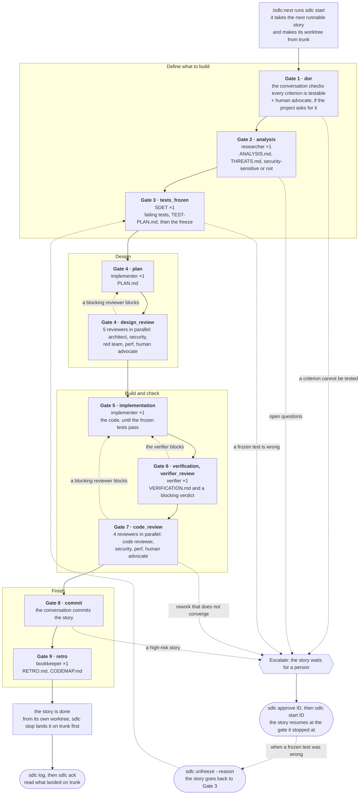

# The loop

- [Introduction](#introduction)
- [The shape of it](#the-shape-of-it)
- [From start to end](#from-start-to-end)
  - [The staffing](#the-staffing)
- [Gate 1 — `dor`, definition of ready](#gate-1--dor-definition-of-ready)
- [Gate 2 — `analysis`](#gate-2--analysis)
- [Gate 3 — `tests_frozen`](#gate-3--tests_frozen)
- [Gate 4 — `plan`, then `design_review`](#gate-4--plan-then-design_review)
- [Gate 5 — `implementation`](#gate-5--implementation)
- [Gate 6 — `verification`, then `verifier_review`](#gate-6--verification-then-verifier_review)
- [Gate 7 — `code_review`](#gate-7--code_review)
- [Gate 8 — `commit`](#gate-8--commit)
- [Gate 9 — `retro`](#gate-9--retro)
- [Rework](#rework)
- [Why approvals go stale](#why-approvals-go-stale)
- [Where everything lives](#where-everything-lives)
- [More than one checkout](#more-than-one-checkout)
  - [Starting a story in a worktree](#starting-a-story-in-a-worktree)
  - [Running stories in parallel](#running-stories-in-parallel)
  - [Claims and release](#claims-and-release)
  - [Done when it lands](#done-when-it-lands)
  - [Parallel stories and `CODEMAP.md`](#parallel-stories-and-codemapmd)
  - [Removing a worktree](#removing-a-worktree)
  - [Upgrading, and unusual repositories](#upgrading-and-unusual-repositories)

## Introduction

The loop takes one story at a time through nine gates. If you have
read [Getting started](getting-started.md), you have already seen it run. This
page explains how it works, so that what the tool does and refuses to do feels
less like magic.

Each section below says what a gate is for, who does it, what it produces, and
what the tool refuses if you try to pass it without doing it. Don't worry if
the names are new: start with [From start to end](#from-start-to-end), which
follows one story, and come back to a gate's section when you meet it.

Each gate leaves a record in the story's gate record, under a key such as `dor`
or `plan`. There are eleven keys, because Gates 4 and 6 each record the work and
then the review of it: the plan and its design review, and the verification and
the verdict on it. Below, a gate is one of the nine and a key is one of the
eleven.

A few more words are used with a fixed meaning throughout:

- **freeze**: the content hashes in `.sdlc/state/tests.lock`. Frozen tests are
  the ones the implementer cannot touch, and only a person unfreezes them.
- **escalate**: hand the story to a person and end the iteration. The story is
  then `awaiting_human`.
- **blocking** and **advisory**: whether a reviewer's `block` stops the gate. An
  advisory review is still required, never skipped.
- **a person**: whoever is at the keyboard. `approve`, `unfreeze` and `ack` are
  theirs alone, and so are a few more commands: see
  [a person's decisions](enforcement.md#a-persons-decisions-refused-in-every-session).
- **the conversation** (also called the assistant): the main Claude Code
  session that runs the skill and hands each gate to an agent.

## The shape of it

Every gate follows the same shape, and the shape is the point:

1. Work is delegated to an agent that starts from a fresh context.
2. The agent stores what it produced **through the tool**, never as a file it
   writes itself.
3. The outcome is recorded, and the tool refuses to record a pass unless the
   work is actually there.

Nothing is taken on trust, including the assistant running the loop. A summary
saying a document exists is not the document.

## From start to end

A person types `/sdlc:next`. The story is checked for readiness, analysed, and
given tests that fail and are then frozen. A plan is written and reviewed, the
code is written until the frozen tests pass, and it is verified and reviewed
again. Then it is committed, and a retro is written. If anything is wrong the
loop goes back to the gate that can fix it. If it cannot fix it, it escalates:
it hands the story to a person and waits
([Human approval gates](guides/human-approval-gates.md) shows what you then
see). By default each story is worked in a
checkout of its own, a worktree, and `sdlc stop` lands the finished story on
trunk (see [more than one checkout](#more-than-one-checkout)).

Here is the same journey, gate by gate. Solid arrows are the way through;
dotted ones are the ways back. Rounded boxes are what only a person does: the
hook refuses `approve`, `unfreeze` and `ack` from an agent, as it does the other
[decisions that are a person's](enforcement.md#a-persons-decisions-refused-in-every-session).



Read the table a row at a time: each row is a gate, with the keys it records,
who does the work, who reviews it, what it produces and where a person may be
needed. The sections after it say the same in full.

| Gate | Record keys | Who does the work | Who reviews it | Produces | Where a person comes in |
| --- | --- | --- | --- | --- | --- |
| 1 | `dor` | the conversation | `sdlc:human-advocate`, advisory, only with `human_gates.dor_advocate_check` | nothing | a criterion that cannot be tested |
| 2 | `analysis` | `sdlc:researcher` | none | `ANALYSIS.md`, `THREATS.md`, and whether the story is security-sensitive | open questions |
| 3 | `tests_frozen` | `sdlc:sdet` | none | the failing tests, `TEST-PLAN.md`, the freeze | `sdlc unfreeze`, when a frozen test is wrong |
| 4 | `plan`, `design_review` | `sdlc:implementer` | `sdlc:architect` blocks; `sdlc:security` blocks when the story is security-sensitive; `sdlc:perf` blocks only on a stated budget; `sdlc:red-team` and `sdlc:human-advocate` are advisory | `PLAN.md`, up to five reviews | a reviewer that keeps blocking |
| 5 | `implementation` | `sdlc:implementer` | none | the code | a broken freeze |
| 6 | `verification`, `verifier_review` | `sdlc:verifier` | the verifier's own verdict blocks | `VERIFICATION.md` | a verifier that keeps blocking |
| 7 | `code_review` | nobody: the diff from Gate 5 is reviewed | `sdlc:code-reviewer` blocks unless `reviews.gate7_advisory`; `sdlc:security`, `sdlc:perf` and `sdlc:human-advocate` as at Gate 4 | up to four reviews | a reviewer that keeps blocking |
| 8 | `commit` | the conversation | none | the commit | `sdlc approve`, for a story in a paused risk tier (`high` by default) |
| 9 | `retro` | `sdlc:bookkeeper` | none | `RETRO.md`, and `CODEMAP.md` for anything new | `sdlc log` and `sdlc ack`, once the story is on trunk |

### The staffing

The staffing is, for one story, which agents the story needs and the model
and effort each is asked for, with a reason for each. It is recorded in the
story's gate record by `sdlc:project-manager` where the project has
[`staffing.enabled`](configuration.md#staffing), and a gate then waits only for
the reviewers the story needs. It is not the plan: the plan is Gate 4's
document, and says how the change is made, not who makes it.
[Agents](agents.md#the-staffing) says how it is chosen and where to read it.

Twelve agents take part. With the staffing off, a story that needs no rework
runs agents fifteen times: one each at Gates 2, 3, 5, 6 and 9, six at Gate 4 and
four at Gate 7, plus the human advocate at Gate 1 when the project asks for it.
With it on, `sdlc:project-manager` runs twice more, after Gates 1 and 2, and each
reviewer it leaves out is one run fewer at Gate 4, Gate 7 or both. Every one
starts from a fresh context, and none reads another's work at the same gate. A
gate that keeps failing, or a reviewer that keeps blocking, hands the story to a
person after [`loop.max_rework_rounds`](configuration.md#loop) failures or
`loop.max_review_rounds` blocks.

## Gate 1 — `dor`, definition of ready

**Who:** the conversation. **Produces:** nothing. Gate 1 is also called `dor`,
definition of ready, and "Select" in the README's table.

The story is selected and its acceptance criteria are read as a test author
would read them. A criterion that describes an implementation rather than an
observable behaviour fails the gate here, which is the cheapest place in the
loop to find out.

**Refused without it:** a pass for a story with no acceptance criteria.

A new story starts only from a trunk fit to start from (the worktree is
explained under [more than one checkout](#more-than-one-checkout)). `sdlc start` refuses a
trunk behind `origin` when [`git.remote`](configuration.md#git) is on, and a
trunk that fails `commands.smoke` in the story's new worktree. With
[`git.worktrees`](configuration.md#git) off, where the story begins in the
checkout itself, it also refuses another branch and uncommitted work that
belongs to no story. A story picked up again is not held to any of it: its own
work is in the tree.

With [`human_gates.dor_advocate_check`](configuration.md#human_gates) on,
`sdlc:human-advocate` reads the story first, as the person it is for would, and
the gate waits for its review. The review is advisory, and it goes stale if the
story changes after it.

## Gate 2 — `analysis`

**Who:** `sdlc:researcher`. **Produces:** `ANALYSIS.md`, `THREATS.md`.

The story is read against the codebase before anything is written: what exists,
what it touches, what the current behaviour actually is with `file:line`, and
what could go wrong at each trust boundary it crosses. It also decides whether
the story is security-sensitive, which is what makes the security reviewer
blocking at Gates 4 and 7.

Open questions stop the loop rather than being guessed at, because everything
downstream is built on this.

**Refused without it:** a pass with either document missing.

## Gate 3 — `tests_frozen`

**Who:** `sdlc:sdet`. **Produces:** `TEST-PLAN.md`, the tests, and the freeze.

Each acceptance criterion becomes a test that fails now, for the reason the
criterion names. The test plan maps every criterion to the test that covers it
and says why each fails today.

Then `sdlc freeze` records the sha256 of every test file. From this moment
nobody edits them: not the implementer, not the agent that wrote them, not the
conversation. `sdlc unfreeze --reason "..."` lifts it, puts the reason on the
record, and sends the story back to this gate. A person runs it in their own
terminal, because the hook refuses it from an agent.
[When a frozen test is wrong](guides/when-a-frozen-test-is-wrong.md) walks
through it.

The freeze belongs to the iteration. It survives `sdlc stop` and a new session,
so resuming a story finds its tests still locked; it is lifted when the story
finishes, so the next story freezes its own.

**Refused without it:** a pass with no test plan, no freeze, a freeze belonging
to another story, or a frozen file that has changed or vanished.

This is the gate the rest of the loop rests on. An agent that can edit its own
acceptance tests will eventually do so, usually because it is the shortest path
to green, and every gate after that means nothing.

## Gate 4 — `plan`, then `design_review`

**Who:** `sdlc:implementer` writes it; `sdlc:architect`, `sdlc:security`,
`sdlc:red-team`, `sdlc:perf` and `sdlc:human-advocate` review it.
**Produces:** `PLAN.md` and up to five reviews.

The plan is the smallest change that makes the frozen tests pass, in steps
somebody else could follow, with the alternative that was rejected and why.

The reviewers run in parallel and do not read each other's work. The architect
blocks; security blocks when the story is security-sensitive; perf never has to
approve, but its block stops the gate, because it blocks only on a performance
budget the contract states. Red-team and human-advocate report but cannot stop
the gate, and none of the five can be skipped (unless the project's staffing
leaves one out for this story, see [The staffing](#the-staffing)).

**Refused without it:** a pass with the plan missing, a reviewer that has not
reported, a blocking reviewer that has not approved, a block from perf, or an
approval of a plan that has since changed.

## Gate 5 — `implementation`

**Who:** `sdlc:implementer`. **Produces:** the code.

The plan is carried out one step at a time, running the tests after each. The
implementer cannot touch any test file, and cannot add a new one.

**Refused without it:** a pass when the freeze is gone or broken.

## Gate 6 — `verification`, then `verifier_review`

**Who:** `sdlc:verifier`. **Produces:** `VERIFICATION.md` and a blocking verdict.

A verifier that has not seen the implementer's reasoning re-derives what each acceptance
criterion should mean, compares that with the frozen tests, runs every command
the project configures, and hunts by hand for the thing tests cannot catch: an
implementation that passes them without the behaviour being there. It checks
every gaming vector the red team named at Gate 4.

**Refused without it:** a pass with the verification document missing, a broken
freeze, or a verifier that blocked or has not approved the current tree.

## Gate 7 — `code_review`

**Who:** `sdlc:code-reviewer`, plus `sdlc:security`, `sdlc:perf` and
`sdlc:human-advocate`. **Produces:** up to four reviews.

The diff is reviewed in a context that never saw the reasoning that produced it.
That is the whole value: a reviewer that inherited the justification cannot
notice what only makes sense if you already knew why.

**Refused without it:** the same conditions as the design review, against the
tree rather than the plan.

## Gate 8 — `commit`

**Who:** the conversation. **Produces:** the commit.

`git commit` is refused by the hook until every gate above has passed, and the
refusal names the one that has not. With [`git.worktrees`](configuration.md#git)
on, the commit is made in the story's worktree, on `story/<ID>`, and trunk does
not move until the story lands at the end of Gate 9
([more than one checkout](#more-than-one-checkout)). The pass then says
`committed on story/<ID> in <start>..<end>` rather than `landed in`.

The gate also asks the verifier and the code reviewer about the tree as it is
now, not as it was when they approved. An approval goes stale the moment the
code changes, and the window between the code review and the commit is the one
place that would otherwise not be checked.

A story whose risk tier the project pauses (`high`, by default) waits here for
a person as well. The conversation hands it over with `sdlc escalate` and stops,
and the commit is refused until somebody has approved the work as it stands. See
[`human_gates`](configuration.md#human_gates).

Passing the gate records the commits the story landed in, as a range: the ones
since code review first passed that the loop watched the session land, as far as
the hook could tell a command was a commit. A person's commit made in that
window is left out. [`sdlc gate`](commands.md#sdlc-gate-gate-status) has what
the pass prints.

> [!NOTE]
> The range is not proof, and not complete. Where no single range holds only
> the watched commits (somebody else's sits between two of the story's), the
> gate records no range, and says so, rather than one that would hold theirs.
> Where the hook watched nothing, the range runs from HEAD when code review
> first passed to HEAD when the commit gate last passed, as it always did, and
> can hold anybody's commits. A commit the hook did not watch is missing from
> it, and history rewritten under the loop can put a person's commit in it.
> [Reviewing what landed on trunk](guides/reviewing-what-landed-on-trunk.md#ranges-to-read-with-care)
> says what to read with care.

A hash the note names has to be inside the range
([`SDLC-E0049`](troubleshooting.md#sdlc-e0049)). The end goes when the commit
gate stops standing, and the next pass records its answer again. The start
stays: a finished story reopened later keeps it, so its range can also span
everything that landed on trunk in between.

**Refused without it:** a pass while anything is uncommitted, with a broken
freeze, with code that has changed since the reviewers saw it, or, in a paused
tier, with work no person has approved.

## Gate 9 — `retro`

**Who:** `sdlc:bookkeeper`. **Produces:** `RETRO.md`.

What deviated from the plan, what sent the story back and where it could have
been caught one gate earlier, what this story actually demonstrated, and what
was deliberately left undone.

**Refused without it:** a pass with the retro missing.

Passing it is also what finishes the story. With `git.worktrees` off, or for a
story worked in the checkout that started it, no gate is left unpassed, so the
story's status becomes `done` in the backlog. End the iteration with
`sdlc stop`, and the next `sdlc start` takes the next story rather than
reopening this one, because it refuses to start a finished story at all. You
commit the backlog change along with the retro.

In a story's worktree the story is done when it lands. The session commits the
bookkeeper's change to `CODEMAP.md`, if it made one, on `story/<ID>` as a
`docs:` commit of its own (the one commit the hook allows after the retro, and
only of that file) and then runs `sdlc stop` in the worktree, which lands both
commits on trunk ([more than one checkout](#more-than-one-checkout)). Until it
does, `sdlc start` there says the story waits to land, and `sdlc status` says
so too. The record and the backlog change wait in the main checkout for a person
to commit them.

## Rework

A gate that fails is recorded as failed, and the loop goes back rather than
around:

```console
$ sdlc gate design_review fail --note "architect blocked: AC-3 has no step"
```

There is no flag that skips a gate, and a pass cannot be recorded out of order.
When a reviewer blocks, the way past is the same reviewer looking again. Its new
verdict replaces the old one, because a gate reads the latest.

Rework does not go round for ever. A gate recorded as failed
[`loop.max_rework_rounds`](configuration.md#loop) times, or a reviewer that
blocks `loop.max_review_rounds` times, hands the story to a person: the rework
is not converging, and another round would meet the same wall. The count starts
again once the person has answered.

Recording a gate again, pass or fail, reopens every gate after it: each goes
back to `pending`, with a note saying why, and has to be passed again. A new
plan cannot inherit the design review of the old one. The command names the
gates it reopened. [When a reviewer
blocks](guides/when-a-reviewer-blocks.md) shows a rework round from the
reviewer's side.

This holds after the story is finished, too. Recording a gate as failed on a
story already marked `done` puts it back to `in_progress`: being done is a
reading of the gate record, not a door that locks behind you. It is also the
only way back in, which is what keeps reopening a decision somebody made rather
than a side effect of running a command.

## Why approvals go stale

A review is stamped with what was in front of it: the story's entry in the
backlog at Gate 1, the plan's content at Gate 4, the whole working tree for the
verifier's review and the code review. Change the plan, or touch a line of code,
and every approval of the old one becomes stale and the gate says so.

The loop's own directory is left out of that tree hash. Recording a review
writes a file under `.sdlc/`, so counting it would make every review stale the
instant it was filed.

The `status` and `updated` fields of each story in the backlog are left out
too. `sdlc` writes them as a story starts, waits for a person and resumes, and none of that
is the work a reviewer approved. Everything else in the backlog counts: change a
story's title or its acceptance criteria after the review, and the review is
stale.

## Where everything lives

Once you have run a story, you may wonder where its files went. This is the
layout of `.sdlc/`:

```text
.sdlc/
  config.json                    the settings
  state/
    active                       the story being worked on
    tests.lock                   the freeze: every test file, by content
  stories/
    AUTH-3/
      gate-record.json           every gate, event and review, in order
      ANALYSIS.md                gate 2
      THREATS.md                 gate 2
      TEST-PLAN.md               gate 3
      PLAN.md                    gate 4
      VERIFICATION.md            gate 6
      RETRO.md                   gate 9
      reviews/
        design_review-architect-1.md
        code_review-code-reviewer-1.md
  worktrees/
    .gitignore                   keeps the worktrees out of git status
    AUTH-3/                      the story's own checkout, on story/AUTH-3
```

The stories directory is all text in your repository, which is what makes it
reviewable; a worktree is a whole checkout. Claims, which say which checkout
holds a story, live in your git directory instead
([more than one checkout](#more-than-one-checkout)). Whether you commit `.sdlc/`
is your decision; the loop writes no `.gitignore` of yours, and the one in
`.sdlc/worktrees/` ignores only that directory.

## More than one checkout

By default each story is worked in a checkout of its own, a git worktree, so
that your own checkout is left alone. This section explains how the checkouts
relate, how a story lands on trunk, and how to clean up a worktree. Read it when
you work several stories at once, or from several checkouts.

A repository can have more than one **checkout**: the **main checkout**, the one
`git clone` or `git init` made, and any number of **linked worktrees** made from
it with `git worktree add`. Every checkout of one repository works the same
backlog and the same record of each story, and those are kept in the main
checkout. A command run in a linked worktree reads and writes them there, and
the copies git checked out in the worktree are never read or written. What is
under `.sdlc/state` is each checkout's own: the story it is running, the
session working it, its freeze and its Stop guard's count. So is
`.sdlc/config.json`, which each checkout reads for itself, trunk included.

### Starting a story in a worktree

Several checkouts can each work a story they hold at once, and with
[`git.worktrees`](configuration.md#git) on, the default, `sdlc start` makes the
checkout for each new story itself: a linked worktree at `.sdlc/worktrees/<ID>`
in the main checkout, on a new branch `story/<ID>` cut from the tip of the local
trunk branch. It makes the worktree and runs `commands.smoke` in it before it
records anything, so a start that fails leaves no claim behind, and takes the
worktree and the branch away again or says what it could not, such as a file
something still has open on Windows
([`SDLC-E0053`](troubleshooting.md#sdlc-e0053),
[`SDLC-E0041`](troubleshooting.md#sdlc-e0041)). The one other check is that
trunk is not behind `origin` when `git.remote` is on
([`SDLC-E0040`](troubleshooting.md#sdlc-e0040)). The main checkout can be on any
branch, with anything uncommitted in it: the story starts from trunk's commits,
not from the main checkout's files.

The story's worktree holds the story. Its `.sdlc/state` is where the story
runs, every gate and every agent works there, and the story is committed there,
on `story/<ID>`; trunk does not move. The backlog and the story's record stay in
the main checkout, as they do for every checkout. `sdlc start` prints the
worktree's path and its branch, and `/sdlc:next` works the story there
whichever checkout the session that started it was opened in. Started by hand
from another checkout, the story is worked by opening Claude Code in its
worktree and typing `/sdlc:next` there: `/sdlc:next` in a new session in the
checkout start ran in begins the next story instead. A second session that starts from the main
checkout begins the next story in a second worktree while the first is worked.

### Running stories in parallel

A person who wants several stories worked at once runs
[`sdlc parallel`](commands.md#sdlc-parallel-id) from the main checkout: it starts
one headless Claude Code session for each story named, and each session starts its
story in a worktree of its own. Run again, it resumes what is under way. The
sessions cannot ask anything, so what a story needs from a person ends its turn,
and `sdlc parallel` gathers those at the end with the command to run for each.

With `git.worktrees` false, a new story begins on trunk, in the checkout that
has trunk checked out, and `sdlc start` first checks that trunk is fit to start
from ([`SDLC-E0038`](troubleshooting.md#sdlc-e0038) to
[`SDLC-E0041`](troubleshooting.md#sdlc-e0041)). Either way, a linked worktree
made by hand works the stories it already holds, and a story under way that a
person released to it, which `sdlc start` picks up rather than begins.

### Claims and release

The checkout that starts a story **holds** it, and a **claim** says so: a small
file, `<git-dir>/sdlc/claims/<ID>.json`, in the git directory every checkout of
the repository shares, where git never shows it, commits it or pushes it. It names
the story and the checkout's path, and nothing else. A story stays held while it
is stopped part-way or waiting for a person, and the claim goes when the story is
done or dropped.

Another checkout's `sdlc start` passes over a story that is held, and a story
that depends on one waits as it would on any story not done. Naming a held story
to `sdlc start`, `gate`, `artifact write`, `review add`, `cost add`, `freeze`,
`unfreeze`, `escalate` or `approve` in another checkout is refused, and the
refusal names the checkout that holds it
([`SDLC-E0050`](troubleshooting.md#sdlc-e0050)). A held story moves only when a
person **releases** it with [`sdlc release`](commands.md#sdlc-release), after
which `sdlc start` picks it up in any checkout; what the old checkout had not
committed stays there. A checkout that is gone holds its story until then
([`SDLC-E0051`](troubleshooting.md#sdlc-e0051)).

A story held in its own worktree under `.sdlc/worktrees/` is the one exception
for `sdlc start`. A plain `sdlc start` in another checkout passes it over, as
any held story; named, `sdlc start <ID>` in any other checkout, the main
checkout included, picks it up there, in its worktree, and so does
`sdlc start` run in the worktree itself. Picked up in another Claude
Code session, the story is taken over, as `/sdlc:next` takes a story over in
one checkout: the new session is the one held to it, and the `sdlc` commands of
the session that was working it are refused from then on
([`SDLC-E0048`](troubleshooting.md#sdlc-e0048)). With `SDLC_DEBUG_FILE` set,
`sdlc start` logs the takeover with both sessions' ids
([seeing what happened](enforcement.md#seeing-what-happened)).

### Done when it lands

A story worked in its worktree is not done when its
last gate passes. It is done when it **lands**: when trunk moves to the story's
commits by fast-forward, which `sdlc stop` does in the story's worktree once
every gate has passed. Until then trunk does not have it, and a story that
depends on it waits. The landing checks, in order:

- the worktree is clean and on `story/<ID>`, with no rebase or merge part-way;
- trunk has not moved past the story. Where it has, the landing refuses with
  [`SDLC-E0054`](troubleshooting.md#sdlc-e0054) and gives the rebase to run: in
  the story's worktree, `git rebase <trunk>`, and then `sdlc stop` again;
- the commits that would land are the story's alone, with no merge among them,
  change nothing under `.sdlc/` or in the backlog, and leave the root
  `CODEMAP.md` a plain file;
- the frozen tests are as the freeze holds them;
- the change is the one the reviewers saw. A rebase that only moved it keeps the
  reviews, and one that changed it needs them again
  ([`SDLC-E0029`](troubleshooting.md#sdlc-e0029));
- where the story was rebased or changed since the commit gate, the configured
  commands pass on it, as trunk's committed configuration has them
  ([configuration](configuration.md#commands)), and a story in a tier that waits
  for a person is approved again.

Then trunk moves, by fast-forward and never by merge, and nothing is pushed.
The record names the commits that reached trunk, the story becomes `done`, its
claim and its freeze are let go, and its worktree and branch are removed. The
record and the backlog change are written in the main checkout and wait there
for a person to commit them. A refusal changes nothing: trunk stays where it
was, and says so. `sdlc stop` run in the story's worktree with no iteration
running lands a finished story too, after a person has answered an escalation.

### Parallel stories and `CODEMAP.md`

Both stories' bookkeepers usually edit
the root `CODEMAP.md`, so the second story's rebase often stops on a conflict in
its bookkeeper's commit. The runbook abandons the rebase and hands the story to
a person, who resolves `CODEMAP.md` in their own terminal, answers with
`sdlc approve <ID>` in the story's worktree, and runs `sdlc stop` there. No
review is asked for again, because the change the reviewers saw leaves
`CODEMAP.md` out; the commands run, because the story was rebased. A project
that wants fewer of these can mark `CODEMAP.md` in `.gitattributes` with git's
built-in union merge, `CODEMAP.md merge=union`, which keeps both sides' lines.
That is the project's choice, and `sdlc` does not write it.

### Removing a worktree

Each worktree is a whole checkout. The landing removes
the story's own, with the files git ignored in it, and its branch; it keeps one
holding changes nobody committed, or one a person locked, names it, and the
story is still done. Any other stays until a person removes it. In the main
checkout, with trunk checked out:

```console
$ git worktree remove .sdlc/worktrees/US-001
$ git branch -d story/US-001
```

`git worktree remove` refuses a worktree with changes nobody committed: look at
them first with `git -C .sdlc/worktrees/US-001 status`, and check that no
`sdlc start` is running for the story. `git branch -d` refuses a branch whose
commits trunk does not have, and those commits are the story's work: never use
`git branch -D`. A worktree whose directory was deleted by hand is cleared with
`git worktree prune`. A worktree on no branch, as a rebase stopped part-way
leaves it, can hold commits no branch has, and `git worktree remove` loses them
without asking: finish or abort the rebase first. `sdlc doctor` names each
story worktree no claim holds, and says whether its HEAD has commits trunk does
not, on its branch or on no branch;
[`SDLC-E0053`](troubleshooting.md#sdlc-e0053) has the rest.

Do not tidy the main checkout with `git clean -x`. `.sdlc/worktrees/` ignores
itself, which is what keeps it out of `git status`, and `git clean -x` with `-f`
given twice removes every story worktree in it, with the work nobody committed
there.

### Upgrading, and unusual repositories

An iteration that was running when this release was installed has no claim.
The checkout whose `.sdlc/state/active` names it holds it, as before, and the
first `sdlc` command there that writes records the claim. Where more than one
checkout names the same story that way, which a worktree cut from a commit
carrying `.sdlc/state` does, none of them holds it: each is refused until a
person runs `sdlc stop` in all but the one they are working in. With a linked
worktree about, an `active` naming a story nobody holds, such as one a person
set to `blocked` by hand, is passed over by `sdlc start`; in a repository with
one checkout it is resumed as it always was.

A repository with no main checkout to keep the backlog in (a worktree of a
bare clone, or of one made with `git init --separate-git-dir`) is refused
([`SDLC-E0052`](troubleshooting.md#sdlc-e0052)). Every checkout runs the
`sdlc` on your `PATH`, so every one of them runs the same release.
[Enforcement](enforcement.md#a-repository-with-more-than-one-checkout) says how
the hook holds a session to its own checkout.
